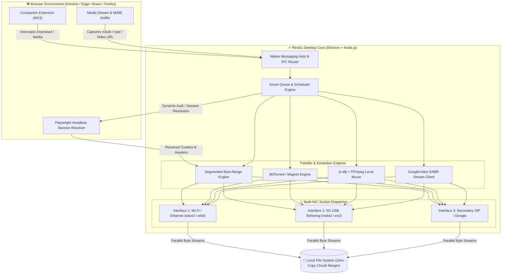
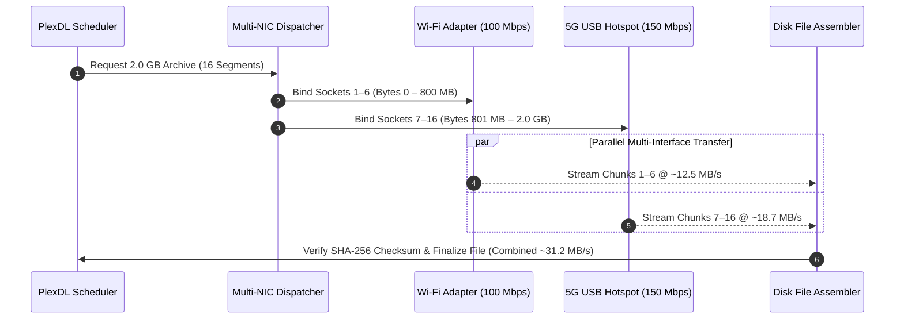

<div align="center">

  

  # ⚡ PlexDL

  **Next-Generation Multi-Network Download Manager & Automated Media Extraction Engine**

  <p align="center">
    <a href="#-key-features"></a>
    <a href="https://www.electronjs.org/"></a>
    <a href="https://nodejs.org/"></a>
    <a href="https://playwright.dev/"></a>
  </p>
  <p align="center">
    <a href="#-media-engine"></a>
    <a href="#-media-engine"></a>
    <a href="#-license"></a>
    <a href="#-installation--setup"></a>
  </p>

  <p align="center">
    <a href="#-overview">Overview</a> •
    <a href="#-system-architecture">Architecture</a> •
    <a href="#-key-features">Features</a> •
    <a href="#-performance-comparison">Performance</a> •
    <a href="#-tech-stack">Tech Stack</a> •
    <a href="#-installation--setup">Installation</a> •
    <a href="#-building-for-production">Building</a> •
    <a href="#-configuration">Configuration</a> •
    <a href="#-project-structure">Structure</a> •
    <a href="#-roadmap">Roadmap</a>
  </p>

</div>

---

## 📖 Overview

**PlexDL** is a privacy-first, open-source desktop download manager and stream harvester built for developers, data archivists, and power users. It unifies two core engineering capabilities into a single minimalist workspace:

1. **Multi-Interface Bandwidth Aggregation (Plexo Core):** Binds HTTP/HTTPS sockets across multiple active network interfaces simultaneously—such as combining home Wi-Fi/Ethernet with a USB-tethered 5G mobile hotspot—to eliminate single-ISP bottlenecks and dramatically boost transfer speeds.
2. **Automated Media & Stream Extraction (PlexDL Core):** Pairs a multi-threaded byte-range transfer engine with browser companion hooks, Playwright session resolution, embedded `yt-dlp`, GoogleVideo SABR protocol handling, and local `ffmpeg-static` muxing to capture direct files, HLS/DASH video streams, and audio with zero telemetry.

---

## 🧬 System Architecture

### End-to-End Pipeline



### Multi-Network Chunk Distribution



---

## ✨ Key Features

### 🔀 1. Multi-Network Socket Binding & Link Aggregation
* **Simultaneous Interface Routing:** Distributes a single download across all active network adapters (Wi-Fi, Ethernet, 5G USB tethering, or secondary mobile dongles) using low-level Node.js `localAddress` socket binding.
* **Dynamic Load Balancing:** Monitors per-interface throughput and latency, reallocating byte ranges dynamically when one adapter experiences throttling or congestion.
* **Failover & Metered Data Protection:** Safely redirects in-flight chunks to surviving adapters if an interface drops, and supports per-adapter data quotas to protect cellular limits.

### ⚡ 2. High-Speed Segmented Transfer Engine
* **Adaptive Byte-Range Chunking:** Opens parallel HTTP/HTTPS range connections with dynamic work-stealing (automatically sub-chunking the largest remaining segment when a connection finishes early).
* **Chunk Matrix Visualization:** Real-time visual progress matrix with fluid vertical fill animations and glowing status indicators for active, buffered, and completed byte ranges.
* **Crash Resilience & Atomic Resume:** Automatic crash recovery using `.plexdl.part` state maps with post-download SHA-256 checksum verification.

### 🎥 3. Integrated Media Extraction & Local Muxing
* **`yt-dlp` Native Wrapper:** Extracts video, audio, subtitles, and playlists from 1,000+ streaming platforms with automatic format selection up to 4K/8K 60fps.
* **`ffmpeg-static` Processing:** Seamlessly combines separated adaptive video and audio tracks locally, converts containers (`mp4`, `mkv`, `mp3`, `opus`), and embeds metadata.
* **HLS / DASH Harvester:** Downloads segmented `.m3u8` and `.mpd` streaming playlists concurrently and reconstructs lossless continuous media files.
* **GoogleVideo SABR Protocol:** Built-in protocol client for resilient media track discovery and direct browser session handoff.

### 🔌 4. Browser Native Companion & Privacy
* **Seamless Browser Takeover:** Manifest V3 extension for Chrome, Edge, Brave, and Firefox captures downloads and in-page video players directly from page elements and context menus.
* **Loopback Native Messaging:** Zero-latency inter-process bridge connecting the browser extension directly to the desktop app via authenticated stdio messaging.
* **100% Client-Side & Zero Telemetry:** No telemetry, no external accounts, no cloud dependencies, and no third-party tracking scripts.

---

## 📊 Performance Comparison

| Metric / Capability | Standard Browser | Classic Download Manager | **PlexDL Engine** |
| :--- | :--- | :--- | :--- |
| **Max Concurrent Connections** | 1 – 6 per host | 8 – 32 (Single NIC) | **Up to 64 across Multiple NICs** |
| **Multi-Network Aggregation** | ❌ No | ❌ No | ✅ **Yes (Wi-Fi + Ethernet + 5G Hotspot)** |
| **HLS / DASH Stream Capture** | ❌ No | ⚠️ Partial / Proprietary | ✅ **Native (`yt-dlp` + `ffmpeg-static`)** |
| **Chunk Progress Matrix** | ❌ Flat bar only | ⚠️ Basic numbers | ✅ **Visual Matrix with Liquid Fill** |
| **Headless Auth / Token Resolution** | ❌ No | ❌ No | ✅ **Playwright Powered** |
| **BitTorrent & Magnet Support** | ❌ No | ❌ Rare | ✅ **Multi-Interface DHT Engine** |
| **Telemetry & Adware** | ⚠️ Varies | ❌ Often Bundled | ✅ **100% Open Source & Ad-Free** |

---

## 🛠️ Tech Stack

| Layer | Technology | Role |
| :--- | :--- | :--- |
| **Desktop Runtime** | Electron 28+, Node.js 20 LTS | Cross-platform desktop shell, native OS integration, filesystem I/O |
| **Networking Core** | Node `net` / `http` / `https` / `http2` | Low-level `localAddress` socket binding and multi-NIC byte dispatch |
| **Browser Automation** | Playwright | Headless token extraction, cookie syncing, and DOM stream sniffing |
| **Media Pipeline** | `yt-dlp`, `ffmpeg-static`, GoogleVideo SABR | Stream manifest parsing, audio/video demuxing, and container muxing |
| **Companion Extension** | Manifest V3 (WebExtensions API) | Browser download interception and loopback Native Messaging bridge |
| **Frontend UI** | Obsidian & Alabaster Minimalist UI | Vanilla JS + Modern CSS with frosted glass, matrix grids, and SVG charts |

---

## ⚙️ Installation & Setup

### Prerequisites
* **Node.js** `v18.18.0` or higher (`v20 LTS` recommended)
* **npm** `v9+` or **pnpm** `v8+`
* **Git**

### 1. Clone & Install Dependencies

```bash
# Clone the repository
git clone https://github.com/manish-sherawat/PlexDL.git

# Enter the project directory
cd PlexDL

# Install core and workspace dependencies
npm install
```

### 2. Download Media Binaries (`yt-dlp` & `ffmpeg`)

```bash
# Automatically verifies ffmpeg-static and downloads latest yt-dlp binary
npm run setup:binaries
```

### 3. Run in Development Mode

```bash
# Starts the Electron app in development mode
npm start
# or
npm run dev
```

### 4. Load the Browser Companion Extension
1. Open Chrome, Edge, or Brave and navigate to `chrome://extensions/`.
2. Enable **Developer mode** via the toggle switch in the top-right corner.
3. Click **Load unpacked** and select the `extension/` folder in the PlexDL repository.
4. PlexDL registers the Windows Native Messaging host automatically on launch. You can also register it manually at any time:
   ```powershell
   powershell -ExecutionPolicy Bypass -File integration/register-native-host.ps1
   ```

---

## 📦 Building for Production

Compile standalone, dependency-free installers and executables:

```bash
# Build Windows NSIS Installer (.exe)
npm run build:win
# (or npm run dist)

# Build Standalone Portable Executable
npm run build:portable
# (or npm run dist:portable)

# Build Unpacked Application Directory
npm run build:dir
# (or npm run package)
```

---

## 🔧 Configuration

PlexDL stores configuration locally in `%USERPROFILE%\.awesome-downloader` or `%APPDATA%\PlexDL\config.json`:

```json
{
  "network": {
    "multiNicEnabled": true,
    "preferredInterfaces": ["Wi-Fi", "Ethernet", "Remote NDIS based Internet Sharing Device"],
    "maxConnectionsPerServer": 16,
    "minChunkSizeMB": 4,
    "dynamicChunkStealing": true,
    "speedLimitKbps": 0
  },
  "media": {
    "defaultVideoFormat": "bestvideo[ext=mp4]+bestaudio[ext=m4a]/best[ext=mp4]",
    "embedSubtitles": true,
    "embedMetadata": true,
    "ffmpegThreads": 4
  },
  "ui": {
    "theme": "obsidian-dark",
    "compactMode": false,
    "chunkGridAnimation": "vertical-fill"
  },
  "privacy": {
    "clearHistoryOnExit": false,
    "telemetry": false
  }
}
```

### CLI Usage

PlexDL can also be scripted directly from the command line:

```bash
# Download a large ISO across Wi-Fi and 5G USB Hotspot with 16 chunks
plexdl fetch "https://releases.ubuntu.com/24.04/ubuntu-24.04-desktop-amd64.iso" \
  --interfaces "Wi-Fi,Ethernet" \
  --chunks 16

# Extract a 4K video stream and mux into MP4
plexdl media "https://example.com/watch?v=stream123" \
  --quality 2160p \
  --format mp4
```

---

## ⌨️ Keyboard Shortcuts

| Shortcut | Action |
| :--- | :--- |
| `Ctrl + N` | New Download / Paste URL or Stream Link |
| `Ctrl + Shift + M` | Open Media & Playlist Extractor (`yt-dlp`) |
| `Ctrl + B` | Open Multi-Network Adapter Binding Panel |
| `Ctrl + P` | Pause / Resume Selected Transfer |
| `Ctrl + Shift + P` | Pause / Resume All Active Queues |
| `Ctrl + ,` | Open Settings & Native Host Manager |
| `Delete` | Remove Selected Download Task from List |

---

## 📂 Project Structure

```text
PlexDL/
├── assets/                      # Hero vector banner and high-res application icons
│   ├── banner.svg               # Project vector hero banner
│   ├── app-icon.svg             # SVG vector application icon
│   └── app-icon.png             # PNG application icon (256x256)
├── build/                       # Packaging scripts, icon assets & Windows NSIS installer
│   ├── browser-setup-helper.exe # Native browser setup assistant
│   ├── icon.ico                 # Windows multi-resolution icon
│   ├── installer.nsh            # NSIS installer hooks
│   └── shell-exec-result.nsh    # Process execution result handler
├── core/                        # Core Transfer & Media Extraction Engines (Node.js ESM)
│   ├── engine.mjs               # Adaptive byte-range chunk scheduler & download queue
│   ├── http.mjs                 # HTTP/HTTPS network client & range probing
│   ├── hls.mjs                  # HLS / m3u8 stream parser & segment worker
│   ├── mux.mjs                  # Local audio/video multiplexing via FFmpeg
│   ├── sabr.mjs                 # GoogleVideo SABR protocol stream handler
│   ├── youtube.mjs              # YouTube media stream extractor & format resolver
│   ├── bridge.mjs               # IPC bridge between core engine and desktop process
│   └── stream-progress.mjs      # Stream chunk and progress calculation utilities
├── desktop/                     # Electron Main Process & Native OS Bridge (CommonJS)
│   ├── main.cjs                 # App lifecycle, window management & IPC handlers
│   ├── preload.cjs              # Secure context bridge exposing desktop API to UI
│   ├── browser-registration.cjs # Windows registry config for Native Messaging
│   ├── browser-setup.cjs        # Browser companion installer helper
│   ├── file-icons.cjs           # Native Windows file icon extractor
│   └── progress-window.cjs      # Mini floating download progress window
├── extension/                   # Chromium & Firefox Manifest V3 Companion Extension
│   ├── manifest.json            # Chromium Extension Manifest (V3)
│   ├── manifest.firefox.json    # Firefox Extension Manifest (V2/V3)
│   ├── background.js            # Download interceptor & Native Messaging client
│   ├── content.js               # In-page media detector & floating action button
│   ├── media-choices.js         # Media quality and resolution picker
│   ├── popup.html               # Quick-capture browser extension popup UI
│   └── popup.css                # Extension popup stylesheet
├── integration/                 # Browser Native Messaging Host Bridge
│   ├── native-host.cjs          # Stdio JSON messaging router
│   ├── NativeHostLauncher.cs    # C# compiled binary launcher for Windows registry
│   └── register-native-host.ps1 # PowerShell one-click native host registry script
├── renderer/                    # Desktop UI (Minimalist Obsidian & Alabaster Design)
│   ├── index.html               # Main dashboard, tab navigation, modals & matrix view
│   ├── app.js                   # Reactive UI controller, state sync & download actions
│   └── styles.css               # Modern CSS theme, glassmorphism & matrix animations
├── scripts/                     # Automation & utility scripts
│   └── fetch-binaries.cjs       # Automated yt-dlp & dependency verification
├── tests/                       # Comprehensive unit & integration test suite (126 tests)
│   ├── engine.test.mjs          # Segmented chunk engine tests
│   ├── http.test.mjs            # Range probing & network tests
│   └── hls.test.mjs             # Stream parser tests
├── vendor/                      # Third-party tools and licensing notices
│   ├── LICENSE.txt
│   └── THIRD_PARTY_LICENSES.txt
├── PLEXO_INTEGRATION_PLAN.md    # Multi-Network Socket Binding Integration Architecture
├── package.json                 # Project dependencies, scripts & build configuration
└── README.md                    # Project documentation
```

---

## 🗺️ Roadmap

- [x] Multi-interface socket binding architectural specification (`PLEXO_INTEGRATION_PLAN.md`)
- [x] High-performance segmented byte-range engine with pause/resume support
- [x] Adaptive liquid vertical fill animation for active chunk blocks
- [x] Embedded `yt-dlp` and `ffmpeg-static` pipeline with local auto-muxing
- [x] GoogleVideo SABR protocol stream handler
- [x] Chromium & Firefox Manifest V3 companion extension with loopback Native Messaging
- [ ] Multi-NIC socket dispatcher implementation (`core/network-manager.mjs`)
- [ ] Per-adapter bandwidth quota caps (e.g., cap mobile hotspot at 2 GB per session)
- [ ] BitTorrent & Magnet link aggregation via DHT / PEX
- [ ] Remote WebUI / headless daemon mode for home servers and NAS environments

---

## 🤝 Contributing

Contributions, issues, and feature requests are welcome!

1. **Fork** the repository: [https://github.com/manish-sherawat/PlexDL](https://github.com/manish-sherawat/PlexDL)
2. **Create** your feature branch:
   ```bash
   git checkout -b feat/multi-nic-failover
   ```
3. **Commit** your changes:
   ```bash
   git commit -m "feat: add automatic socket failover on adapter disconnect"
   ```
4. **Push** to the branch:
   ```bash
   git push origin feat/multi-nic-failover
   ```
5. **Open** a Pull Request

---

## 🙌 Acknowledgments & Credits

PlexDL stands on the shoulders of two open-source projects whose concepts inspired this unified architecture:
* **[Plexo](https://github.com/anmolkapil/plexo)** – Inspiration for multi-network interface binding, link aggregation, and socket allocation.
* **[awesome-downloader](https://github.com/Ahmadkhattak1/awesome-downloader)** – Base architecture, browser integration hooks, and local media processing pipeline.

---

## 📄 License

Distributed under the **MIT License**. See [`LICENSE`](./LICENSE) for full details.
